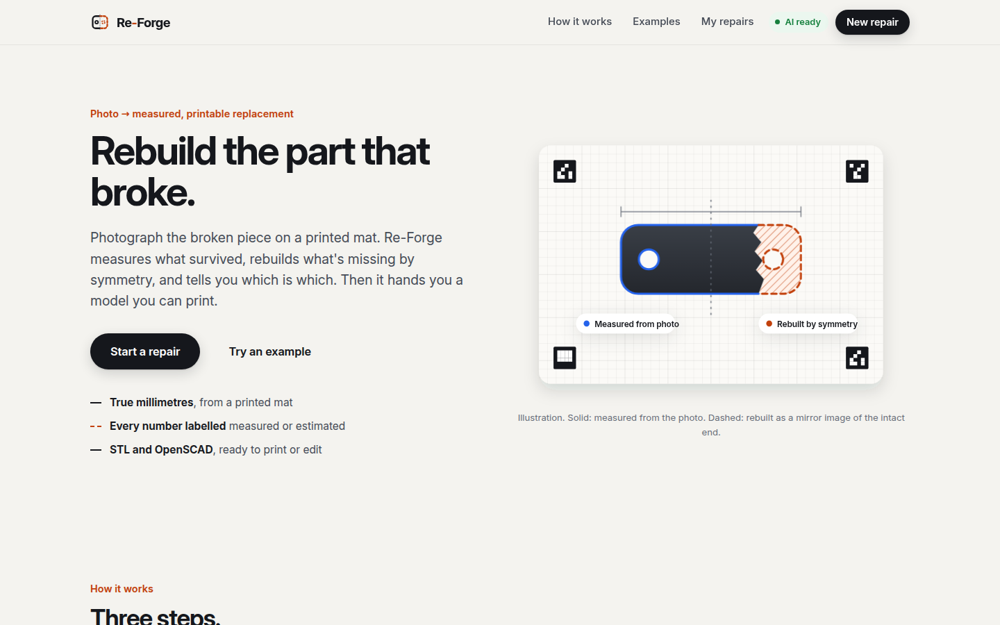
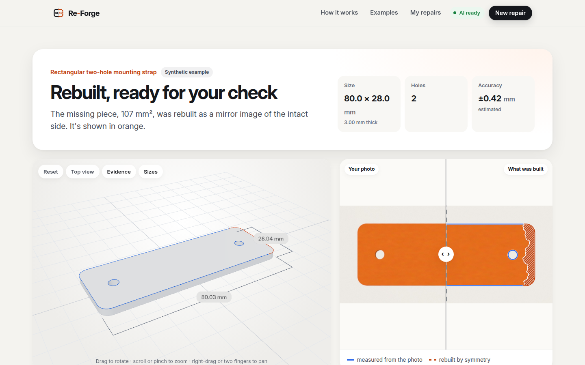
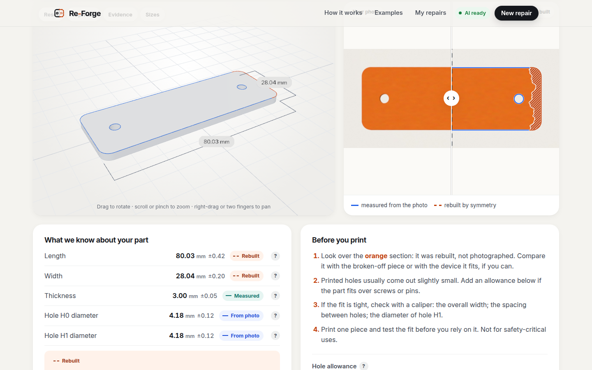
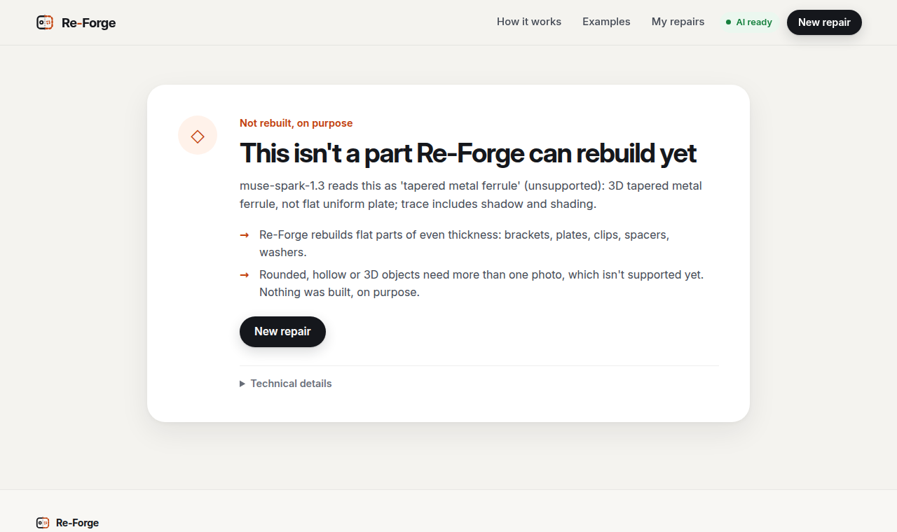

# Re-Forge

**Rebuild the part that broke.** Photograph a broken flat part on a printed mat. Re-Forge measures what survived,
rebuilds what's missing by symmetry, labels every number as measured or estimated, and gives you a printable STL and an
editable OpenSCAD file when the evidence is good enough. When it isn't, it says so and builds nothing it can't support.

Built for the Meta Global AI Developer Hackathon (Indie track, "Push the Frontier"). **All code in this repository was
written during the hackathon**, starting after the kickoff on 26 Oct 2026, 17:00 Paris. The git history and
`docs/PROGRESS.md` record what was built and when. Development was assisted by AI coding tools.

> ⚠️ A reconstruction is not a verified replacement part. Check it before you rely on it. Not for safety-critical use.



## What you get

| | |
|---|---|
|  |  |
| A broken bracket, rebuilt. The orange end is mirrored from the intact one. *(Synthetic example image.)* | Every dimension with its source and a modelled ±U. The export waits for you to review anything uncertain. |

- **True millimetres.** A printed mat with 12 ArUco markers calibrates the photo. A leave-one-out residual reports how
  well, and two 100 mm bars let you check the print scale with a caliper.
- **Evidence labels.** Every dimension is labelled **Measured by you**, **Measured from the photo**, **Rebuilt by
  symmetry** or **Uncertain**, with a 2σ estimate from this photo's own error budget.
- **AI where it's strongest, geometry where numbers matter.**
  - Meta **SAM 3.1** finds the part.
  - Meta **Muse Spark 1.3** reads it: what it is, whether it's a flat part, which edges are broken, and which mirror
    axis to rebuild from.
  - The AI never sets a dimension. Its answer is constrained to the ids drawn on the image, then **checked against the
    geometry** before anything is rebuilt.
  - When it picks a mirror axis that can't rebuild the break, the axis is corrected by geometry and the report says so.
- **Honest refusals.** A pipe, a 3D object, a tool of varying thickness, or a trace that covers only part of what's on
  the mat is refused with the reason. Nothing is built, on purpose.
- **Files you can use.**
  - `model.stl` for your slicer.
  - `model.scad`: OpenSCAD source, with every dimension a named value commented with its evidence.
  - `report.json`: the evidence for every number.
  - An optional hole allowance rebuilds and re-validates both model files.
- **No fake progress.** The progress view shows the pipeline's real stage events and their measured durations.

## Status (honest labels)

✅ implemented and tested · 🟡 implemented, partly verified · 📋 planned · ⛔ unsupported

| Status | Items |
|---|---|
| ✅ | Calibration with a residual and a leave-one-out residual; sub-pixel edge refinement; holes; height (parallax) correction; PartSpec; CAD build (manifold3d); mesh and printability validation; STL and OpenSCAD export; CLI; HTTP API with background jobs and real stage progress; web UI |
| ✅ live, synthetic images | SAM 3.1 segmentation and Muse Spark interpretation via the Meta Model API. On the 3 bundled examples (2026-11-03): sizes within 0.04 mm of the known truth, and the broken flange's two lost holes inferred at Ø 5.495 and 5.497 mm against 5.5 |
| ✅ verified with OpenSCAD itself | The exported `.scad` compiles in OpenSCAD (WASM build) into a watertight solid whose volume matches the STL within 4 × 10⁻⁶, holes compensated or not (`backend/tools/check_exports.py`) |
| 🟡 one real part | A stamped-metal heart on the printed mat: height within +0.31 / +0.41 mm of a caliper reading. The width reading (53 mm, no decimals) disagrees by about −1 mm and is being re-measured |
| 🟡 modelled | The ±U uncertainties are an error budget computed per photo. Their coverage against caliper readings has only been checked on that one real part |
| 📋 | Caliper overrides of single dimensions in the UI, multi-photo fusion, side views for 3D parts |
| ⛔ | Rounded, hollow or 3D parts, threads, multi-thickness parts, safety-critical parts |

Measured numbers, with their dates and conditions, are in [`docs/EVALUATION.md`](docs/EVALUATION.md). Nothing in this
README is a claim beyond what is measured there.

## Quick start

Requires [uv](https://docs.astral.sh/uv/) and Node ≥ 22.12 (see `docs/ENVIRONMENT.md`).

```bash
cp .env.example .env                      # then set META_MODEL_API_KEY (optional: without it, everything runs without AI)
cd frontend && npm ci && npm run build && cd ..
cd backend && uv sync && uv run reforge-api
# open http://127.0.0.1:8000
```

No mat printed yet? Open **Examples** on the home page. Those images are synthetic: rendered parts shot by a
simulated phone camera, so their true size is known. They run through the full pipeline.

**Docker** (one container, the API and the UI on port 8000):

```bash
docker build -t reforge .
docker run --rm -p 127.0.0.1:8000:8000 --env-file .env -v reforge-data:/app/data reforge
```

The key is read from the environment at run time and never baked into the image. To serve it beyond localhost, put it
behind an HTTPS reverse proxy and keep `REFORGE_DAILY_BUDGET_USD` low: every visitor's analysis spends your Meta API
credits.

### Configuration (`.env`)

| Variable | Default | Meaning |
|---|---|---|
| `META_MODEL_API_KEY` | (empty) | Meta Model API key. Without it, the UI offers the no-AI path only |
| `REFORGE_MODEL_SEGMENTATION` / `REFORGE_MODEL_REASONING` | `sam-3.1` / `muse-spark-1.3` | Standard-tier models. User uploads never go to the contributor tier |
| `REFORGE_DAILY_BUDGET_USD` | `5` | Hard cap on estimated Meta API spend per UTC day, checked before every call |
| `REFORGE_HOST` / `REFORGE_PORT` | `127.0.0.1` / `8000` | Where the server listens |
| `REFORGE_MAX_RUNNING_JOBS` / `REFORGE_MAX_QUEUED_JOBS` | `2` / `8` | Concurrency and queue bound; beyond it, new jobs get `SERVER_BUSY` |
| `REFORGE_DATA_DIR` | `data/` | Job folders and the usage ledger |

## Using it

1. **Print the mat** (`/api/mat/A4.pdf` or `/api/mat/Letter.pdf`) at 100 %, "actual size". Optionally, measure its two
   100 mm bars once with a caliper: it removes the print-scale uncertainty.
2. **Photograph** the part flat in the middle of the mat, straight from above, in soft light, with all 12 markers in the
   frame. Upload the phone's original JPEG: its lens information helps the height correction. HEIC isn't read yet.
3. **Enter the thickness** from a caliper. A photo from above can't see it.
4. **Analyse.** About half a minute with AI (24–40 s measured on the examples), a few seconds without.
5. **Review.** Use the 3D view, the before/after slider (photo against what was built), the evidence list and the
   "Before you print" checklist. Anything uncertain must be acknowledged before the files unlock.
6. **Download** the STL (slicer), the `.scad` (editable) or the report. Print one piece and test the fit first.

Past repairs are listed under **My repairs** (kept in this browser only). **Show technical details** reveals the
calibration, the AI reading with the marked image it answered on, the uncertainty budget, the validation checks, the
timings and the AI cost of the job.



## How it works

```
photo on the mat
 1 CALIBRATE   12 ArUco markers → homography, fit and leave-one-out residuals, print-scale correction   (OpenCV)
 2 SEGMENT     Meta SAM 3.1: box prompt from a local colour proposal, noun phrase as fallback           (Meta Model API)
 3 REFINE      sub-pixel edges in linear light against the known mat paper; through-holes by colour     (OpenCV, scikit-image)
 4 HEIGHT      camera pose from the mat; the part's top face is closer to the camera: parallax removed  (geometry)
 5 READ        Meta Muse Spark 1.3 on a Set-of-Mark image (segments S#, axes A#, holes H#), strict JSON
               schema whose enums are only the ids drawn; then geometric verification of every claim   (Meta Model API)
 6 REBUILD     mirror completion with provenance runs: OBSERVED / INFERRED / UNCERTAIN                 (shapely)
 7 BUILD       typed PartSpec → watertight solid; STL + deterministic OpenSCAD source                  (manifold3d)
 8 VALIDATE    watertight, one body, genus = holes, volume and bounds vs the spec, FDM printability    (trimesh)
 9 CONFIDENCE  a 2σ estimate per dimension from this photo's calibration, scale, edge and pose terms
```

No model output is ever executed. If a Meta API call fails, segmentation reports a typed error, and the UI offers to run
the same photo without AI. If the reading fails, the geometric rule takes over and the report labels it "not AI".
Details and decisions: [`docs/PLAN.md`](docs/PLAN.md).

## HTTP API

| Method and path | What it does |
|---|---|
| `GET /api/health` | Whether AI is configured, the model ids, and today's spend against the cap |
| `POST /api/jobs` | Multipart form: one of `photo` (file), `sample` (example id) or `from_job` (re-run a stored photo), plus `thickness_mm`, optional `bar_x_mm`/`bar_y_mm`, `segmenter` (`sam`\|`classical`), `interpreter` (`spark`\|`geometric`), `prompt`, and `wait` (`false` answers `202` with the job id at once) |
| `GET /api/jobs/{id}` | `queued`/`running` with the real stage events, then `done` with the report and file URLs, or `failed` with a typed error |
| `GET /api/jobs/{id}/{file}` | `model.stl`, `model.scad`, `spec.json`, `report.json`, `photo.jpg`, `overlay.png`, `setofmark.png`. For the model files, `?hole_offset_mm=0.2` rebuilds and re-validates with a printer compensation |
| `GET /api/samples` | The bundled example photos, each labelled synthetic, with their known truth |
| `GET /api/mat/{A4\|Letter}.pdf` | The printable mat |

Uploads are capped at 20 MB and 40 megapixels. They are decoded and re-encoded before anything else, so no EXIF or GPS
data survives; only the lens focal length is read first. Job ids are random, and only whitelisted files are served.
Responses carry `nosniff`, a strict Content-Security-Policy and `frame-ancestors 'none'`.

## Tests

```bash
cd backend && uv run pytest            # offline: synthetic scenes, API, contract tests; no network, no cost
cd backend && uv run pytest -m live    # opt-in: real Meta Model API calls (costs a few cents)
cd backend && uv run ruff check .
cd frontend && npm run build           # type-check + production build
```

The export check needs Node: `cd tools/scad-check && npm install`, then
`cd backend && uv run python -m tools.check_exports ../data/jobs/<id>`.

Results of the latest runs are in `docs/EVALUATION.md` (2026-11-03 entries), including the browser tests of every
screen at desktop, tablet and phone widths.

## Repository layout

```
backend/reforge/   capture (mat, calibration, pose) · vision (segment, refine) · geometry · reasoning (Set-of-Mark,
                   Spark, verification, reconstruction) · spec (PartSpec, confidence) · cad · validation · api · cli
backend/tests/     unit, synthetic (rendered scenes with exact truth), live (opt-in)
backend/tools/     test-photo generator, example bundler, export checker, notice generator
frontend/src/      React + three.js UI: pages/, components/, lib/
assets/            the printable mats and the bundled synthetic examples
docs/              PLAN, PROGRESS, EVALUATION, SUBMISSION, DEMO_SCRIPT, guides, screenshots
tools/scad-check/  OpenSCAD (WASM) compiler used to verify the .scad exports
```

## Known limitations

- Flat parts of uniform thickness only (2.5D). No side views, revolved parts or threads.
- One photo per analysis; the ±U is modelled from that photo, not measured across several.
- Accuracy on real photos has been checked on one real part so far (see the status table). On real prints the mat fit
  is 0.19–0.25 mm RMS, mostly paper flatness, against 0.006 mm on synthetic images, so real-photo sizes are about ten
  times less certain, and the UI says so.
- Muse Spark's reading varies between runs on borderline parts (a family verdict, an axis choice). Verification catches
  wrong picks, but a run can still end "not rebuilt" where another run rebuilds.
- Shiny or textured metal can confuse the outline; SAM 3.1 copes better than the no-AI fallback, which can trace cast
  shadows.
- HEIC uploads aren't decoded. Job files stay on the server until deleted (no automatic retention yet).
- The mat must be printed at 100 %. "Fit to page" breaks the assumed scale unless the bars are measured.

## Docs

- [`docs/PLAN.md`](docs/PLAN.md): architecture, decisions and risks
- [`docs/PROGRESS.md`](docs/PROGRESS.md): build log, session by session
- [`docs/EVALUATION.md`](docs/EVALUATION.md): measured results only, with dates and conditions
- [`docs/SUBMISSION.md`](docs/SUBMISSION.md): the hackathon submission form, field by field
- [`docs/DEMO_SCRIPT.md`](docs/DEMO_SCRIPT.md): the 3-minute demo video plan
- [`docs/DEMO_PART_GUIDE.md`](docs/DEMO_PART_GUIDE.md) and [`docs/ENVIRONMENT.md`](docs/ENVIRONMENT.md)

## Licence

Apache License 2.0: see `LICENSE` and `NOTICE`. Third-party packages keep their own licences, listed in
`THIRD_PARTY_NOTICES.md`. The bundled Inter font is under the SIL Open Font License 1.1. SAM 3.1 and Muse Spark are
used through the Meta Model API under Meta's terms; no model weights are included.
