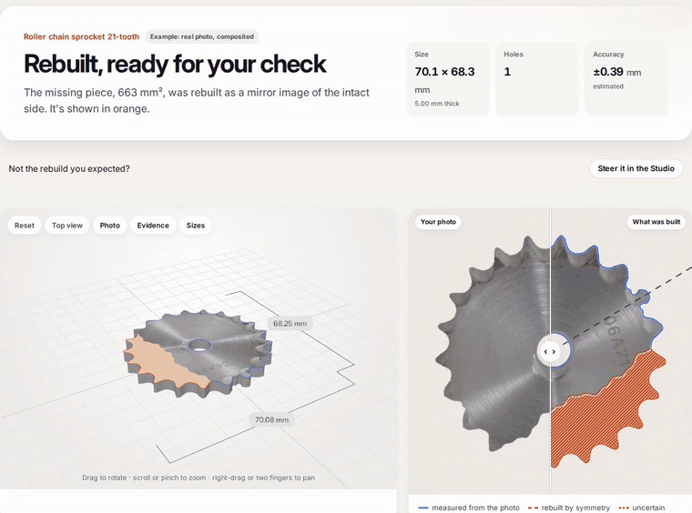
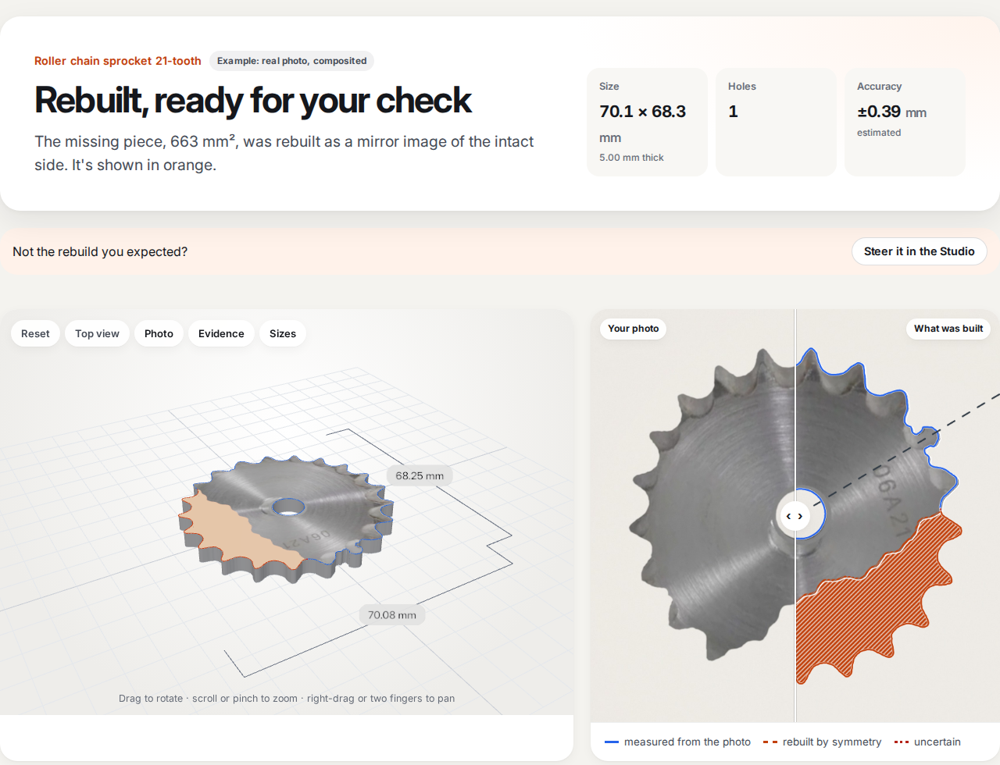
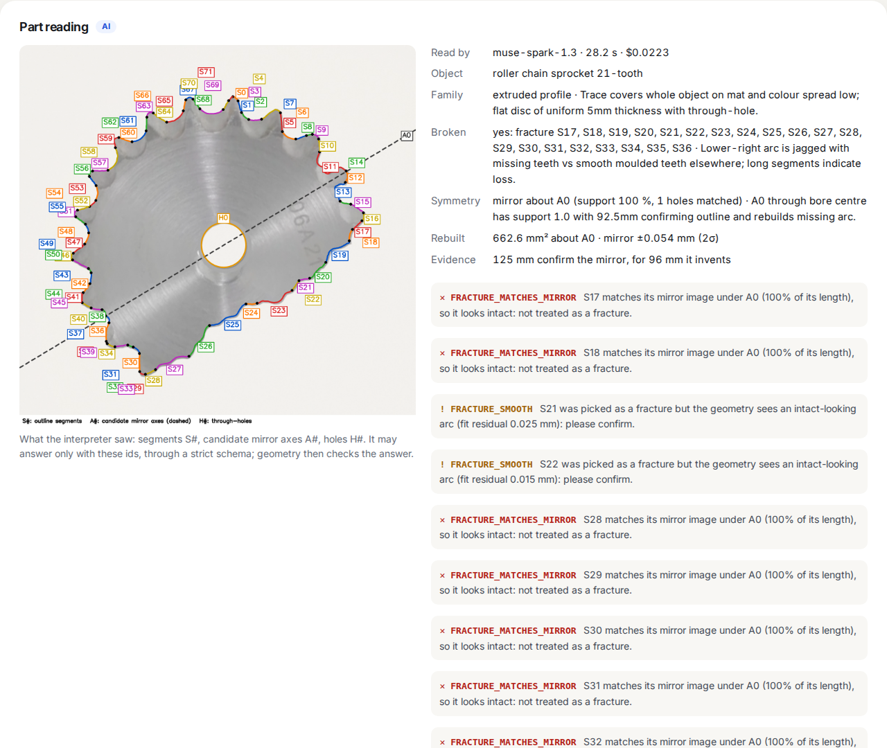

<div align="center">


# Re-Forge

**Photograph a broken flat part. Get back a measured, printable model, with the evidence behind every number.**

[](LICENSE)
[](backend/pyproject.toml)
[](https://fastapi.tiangolo.com)
[](frontend/package.json)
[](frontend/tsconfig.json)
[](https://threejs.org)
[](Dockerfile)
<br>
[](#how-the-ai-is-used)
[](#how-the-ai-is-used)
[](#tests)
[](https://github.com/astral-sh/ruff)
[](#contributing)

[**Live demo**](https://reforge.adidomedis.cloud) · [Quick start](#quick-start) · [How it works](#how-it-works) · [Measured results](docs/EVALUATION.md) · [API](#http-api)



</div>

---

A small plastic or metal part breaks, and there is no spare. Re-Forge turns one phone photo of the broken piece,
laid on a printed calibration mat, into an STL you can slice and an OpenSCAD file you can edit. It measures what
survived in true millimetres, rebuilds what is missing by symmetry, and labels every dimension as **measured**,
**rebuilt** or **uncertain**, with a ±2σ estimate from the photo's own error budget. When the evidence isn't good
enough, it says why and builds nothing.

> [!WARNING]
> A reconstruction is not a verified replacement part. Print or cut one piece and check the fit before you rely on
> it. Not for safety-critical use.

## Features

- **True millimetres.** A printed mat with 12 ArUco markers calibrates the photo. A leave-one-out residual reports how
  well, and two 100 mm bars let you check the print scale with a caliper.
- **AI that reads, geometry that decides.** Meta **SAM 3.1** traces the part; Meta **Muse Spark** names it and points at
  the broken edges and the mirror axis. Every claim is checked against the measured outline before anything is
  rebuilt, and the AI never sets a dimension.
- **Evidence for every number.** Each dimension carries its source (caliper, photo, mirror) and a modelled ±U. Anything
  uncertain must be acknowledged before the downloads unlock.
- **You stay in control.** The Studio shows every candidate axis and edge: pick the mirror, mark the break, or drag the
  outline where the photo misled the tracer. Your edits are labelled in the report.
- **Honest refusals.** No mat in view, a 3D object, a pipe, a part of varying thickness: refused with a typed reason
  and a fix, instead of a confident-looking wrong model.
- **Files you can use.** `model.stl` for the slicer, `model.scad` with every dimension a named, commented value,
  `model.dxf` (R12, mm) and `model.svg` (true size) for parts cut from sheet, and `report.json` with the evidence.
- **Works offline.** Without an API key, a classical tracer and a geometric rule run the same pipeline, and the UI
  says so.

| | |
|:---:|:---:|
|  |  |
| The verdict: blue is measured from the photo, orange is rebuilt. | What the AI saw, what it claimed, and what the geometry rejected. |

## How the AI is used

Two Meta models run through the [Meta Model API](https://api.meta.ai) (standard tier; user uploads never go to the
contributor tier):

1. **SAM 3.1** segments the part on the rectified mat view, from a box prompt derived from a local colour proposal,
   with a noun-phrase fallback.
2. **Muse Spark 1.3** receives the photo and a Set-of-Mark view: the outline cut into numbered segments `S#`, candidate
   mirror axes `A#` and holes `H#`, plus the measured facts as JSON. It answers through a strict JSON schema whose
   enums are generated from the ids actually drawn, so it can only point at things that exist. It never writes code
   and never estimates a dimension.
3. **Geometry verifies every claim.** A "fracture" that matches its mirror image is rejected as intact; an axis that
   can't rebuild the break is replaced by one that passes the same checks, and the report says so.

On the bundled broken sprocket, Muse Spark marked 20 segments as broken; 11 matched their mirror image and were
rejected, and only the real break was rebuilt: 663 mm² of teeth, **70.08 × 68.25 mm against 70.23 × 68.31 mm** for the
intact part, both within ±2σ, for **$0.025** of API calls (SAM 3.7 s, Spark 28 s). Every call goes through one client
with timeouts, retries, a daily budget cap and a usage ledger, so each job shows its real AI cost.

## Quick start

Requires [uv](https://docs.astral.sh/uv/) and Node ≥ 22.12 (details in [`docs/ENVIRONMENT.md`](docs/ENVIRONMENT.md)).

```bash
git clone https://github.com/Juste-medis/reforge.git && cd reforge
cp .env.example .env                      # set META_MODEL_API_KEY (optional: without it, everything runs without AI)
cd frontend && npm ci && npm run build && cd ..
cd backend && uv sync && uv run reforge-api
# open http://127.0.0.1:8000
```

No mat printed yet? Open **Examples** on the home page and run one: rendered parts with an exact truth, real part
photos composited on the mat, and user photos with stored Studio guidance, each labelled for what it is.

### Reviewer path (no key, 5 minutes)

No API key, no printer, no mat needed. Every step below runs offline and says so in the UI.

1. Start the app (commands above) and open the home page.
2. Run an **Example**: pick the broken sprocket, watch the stages run for real, then read the verdict.
3. On the result page, check the Files verdict (the STL reloaded from disk), the replay line under the
   before/after slider (how much of the photo the model covers), and **Show technical details** → Validation
   (every check, the photo and STL fingerprints, `validation.json`).
4. For the honest boundaries, read [`docs/LIMITS.md`](docs/LIMITS.md): what is covered, what is refused,
   and where the numbers come from.

### Docker

One container serves the API and the UI on port 8000:

```bash
docker build -t reforge .
docker run --rm -p 127.0.0.1:8000:8000 --env-file .env -v reforge-data:/app/data reforge
```

The key is read from the environment at run time and never baked into the image. To serve it publicly, put it behind
an HTTPS reverse proxy and keep `REFORGE_DAILY_BUDGET_USD` low: every visitor's analysis spends your API credits.

### Configuration

| Variable | Default | Meaning |
|---|---|---|
| `META_MODEL_API_KEY` | (empty) | Meta Model API key. Without it, only the offline path is offered |
| `REFORGE_MODEL_SEGMENTATION` / `REFORGE_MODEL_REASONING` | `sam-3.1` / `muse-spark-1.3` | Standard-tier models |
| `REFORGE_DAILY_BUDGET_USD` | `5` | Hard cap on estimated API spend per UTC day, checked before every call |
| `REFORGE_HOST` / `REFORGE_PORT` | `127.0.0.1` / `8000` | Where the server listens |
| `REFORGE_MAX_RUNNING_JOBS` / `REFORGE_MAX_QUEUED_JOBS` | `2` / `8` | Concurrency and queue bound; beyond it, new jobs get `SERVER_BUSY` |
| `REFORGE_DATA_DIR` | `data/` | Job folders and the usage ledger |

## Usage

1. **Print the mat** (`/api/mat/A4.pdf` or `/api/mat/Letter.pdf`) at 100 %, "actual size". Measuring its two 100 mm
   bars once with a caliper removes the print-scale uncertainty.
2. **Photograph** the part flat in the middle of the mat, straight from above, in soft light, with all 12 markers in
   the frame. Upload the phone's original JPEG: its lens data helps the height correction.
3. **Enter the thickness** from a caliper. A photo from above can't see it.
4. **Analyse.** About half a minute with AI, a few seconds without.
5. **Review** the 3D view, the before/after slider, the evidence list and the "Before you print" checklist.
6. **Download** the STL, the `.scad`, the DXF or SVG, or the report.

**Show technical details** reveals the calibration, the AI reading with the marked image it answered on, the
uncertainty budget, the validation checks, the timings and the AI cost of the job.

## How it works

```
photo on the mat
 1 CALIBRATE   12 ArUco markers → homography, fit and leave-one-out residuals, print-scale correction   (OpenCV)
 2 SEGMENT     Meta SAM 3.1: box prompt from a local colour proposal, noun phrase as fallback           (Meta Model API)
 3 REFINE      sub-pixel edges in linear light against the known mat paper; through-holes by colour     (OpenCV, scikit-image)
 4 HEIGHT      camera pose from the mat; the part's top face is closer to the camera: parallax removed  (geometry)
 5 READ        Meta Muse Spark 1.3 on a Set-of-Mark image (segments S#, axes A#, holes H#), strict JSON
               schema whose enums are only the ids drawn; then geometric verification of every claim   (Meta Model API)
 6 REBUILD     mirror completion with provenance runs: OBSERVED / INFERRED / UNCERTAIN                 (shapely)
 7 BUILD       typed PartSpec → watertight solid; STL + deterministic OpenSCAD source                  (manifold3d)
 8 VALIDATE    watertight, one body, genus = holes, volume and bounds vs the spec, FDM printability    (trimesh)
 9 CONFIDENCE  a 2σ estimate per dimension from this photo's calibration, scale, edge and pose terms
```

No model output is ever executed. If a Meta API call fails, segmentation reports a typed error and the UI offers to
run the same photo without AI; if the reading fails, the geometric rule takes over and the report labels it.

## HTTP API

| Method and path | What it does |
|---|---|
| `GET /api/health` | Whether AI is configured, the model ids, and today's spend against the cap |
| `POST /api/jobs` | Multipart form: one of `photo` (file), `sample` (example id) or `from_job`, plus `thickness_mm`, optional `bar_x_mm`/`bar_y_mm`, `segmenter` (`sam`\|`classical`), `interpreter` (`spark`\|`geometric`), `prompt`, and `wait` (`false` answers `202` with the job id at once) |
| `GET /api/jobs/{id}` | `queued`/`running` with the real stage events, then `done` with the report and file URLs, or `failed` with a typed error |
| `GET /api/jobs/{id}/{file}` | `model.stl`, `model.scad`, `model.dxf`, `model.svg`, `spec.json`, `report.json`, `photo.jpg`, `texture.jpg`, `overlay.png`, `setofmark.png`. For model files, `?hole_offset_mm=0.2` rebuilds and re-validates with a printer compensation |
| `GET /api/samples` | The bundled examples, each labelled for what it is, with their known truth |
| `GET /api/mat/{A4\|Letter}.pdf` | The printable mat |

Uploads are capped at 20 MB and 40 megapixels and re-encoded before anything else, so no EXIF or GPS data survives.
Job ids are random, only whitelisted files are served, and responses carry `nosniff`, a strict Content-Security-Policy
and `frame-ancestors 'none'`.

## Tests

```bash
cd backend && uv run pytest            # offline: synthetic scenes with exact truth, API and contract tests; no network
cd backend && uv run pytest -m live    # opt-in: real Meta Model API calls (a few cents)
cd backend && uv run ruff check .
cd frontend && npm run build           # type-check + production build
```

196 offline tests pass (5 Nov 2026). The exported `.scad` is also compiled with OpenSCAD (WASM) and checked against
the STL: `cd tools/scad-check && npm install`, then `cd backend && uv run python -m tools.check_exports ../data/jobs/<id>`.

## Status

✅ implemented and tested · 🟡 implemented, partly verified · 📋 planned · ⛔ unsupported

| Status | Items |
|---|---|
| ✅ | Calibration with fit and leave-one-out residuals; sub-pixel edges; holes; height (parallax) correction; mirror rebuild with provenance; PartSpec; CAD build; mesh and printability validation; STL, OpenSCAD, DXF and SVG export; CLI; HTTP API with background jobs; web UI with a photo-textured 3D preview; Studio guidance and outline editing |
| ✅ live | SAM 3.1 and Muse Spark on the bundled examples: broken sprocket 70.08 × 68.25 mm vs 70.23 × 68.31, broken flange 56.01 × 56.00 vs 56 × 56 with its lost holes, broken bracket 80.03 × 28.04 vs 80 × 28 ([`docs/EVALUATION.md`](docs/EVALUATION.md)) |
| ✅ | The exported `.scad` compiles in OpenSCAD into a watertight solid whose volume matches the STL within 4 × 10⁻⁶ |
| 🟡 | One real part photographed on the printed mat: height within +0.31 / +0.41 mm of a caliper reading. The ±U is an error budget per photo; its coverage has only been checked on that part |
| 📋 | Caliper overrides of single dimensions in the UI, multi-photo fusion, side views for 3D parts |
| ⛔ | Rounded, hollow or 3D parts, threads, multi-thickness parts, safety-critical parts |

Measured numbers, with their dates and conditions, are in [`docs/EVALUATION.md`](docs/EVALUATION.md).
What the tool refuses to do, and why, is in [`docs/LIMITS.md`](docs/LIMITS.md).

## Known limitations

- Flat parts of uniform thickness only (2.5D). One photo per analysis.
- Real-photo accuracy has been checked on one real part so far. On real prints the mat fit is 0.19 to 0.25 mm RMS,
  mostly paper flatness, so real-photo sizes are less certain than synthetic ones, and the UI says so.
- Muse Spark's reading can vary between runs on borderline parts; verification catches wrong picks, but one run may
  end "not rebuilt" where another rebuilds.
- Small ragged chips on toothed outlines can be declined: the mirror can't cover a ragged edge exactly.
- A pale part on the white mat traces its holes too roughly to fit circles. HEIC uploads aren't decoded.
- The mat must be printed at 100 %. "Fit to page" breaks the assumed scale unless the bars are measured.

## Project layout

```
backend/reforge/   capture (mat, calibration, pose) · vision (segment, refine) · geometry · reasoning (Set-of-Mark,
                   Spark, verification, reconstruction) · spec (PartSpec, confidence) · cad · validation · studio · api · cli
backend/tests/     unit, synthetic (rendered scenes with exact truth), live (opt-in)
backend/tools/     test-photo generator, example bundler, export checker, notice generator
frontend/src/      React + three.js UI: pages/, components/, lib/
assets/            the printable mats and the bundled examples
docs/              EVALUATION (measured results), guides, screenshots
tools/scad-check/  OpenSCAD (WASM) compiler used to verify the .scad exports
```

## Contributing

Issues and pull requests are welcome. Please run the offline tests and `ruff check` before opening a PR, and keep the
rule the project is built on: a number shown to the user must say where it came from.

## License

Apache License 2.0: see [`LICENSE`](LICENSE) and [`NOTICE`](NOTICE). Third-party packages keep their own licences,
listed in [`THIRD_PARTY_NOTICES.md`](THIRD_PARTY_NOTICES.md). The bundled Inter font is under the SIL Open Font
License 1.1.

The example images follow their sources' terms, not Apache-2.0: credited photos keep their licence (CC BY-SA 3.0 or
public domain), with authors and changes in [`assets/samples/CREDITS.md`](assets/samples/CREDITS.md) and
[`frontend/public/hero/CREDITS.md`](frontend/public/hero/CREDITS.md). SAM 3.1 and Muse Spark are used through the Meta
Model API under Meta's terms; no model weights are included.

## Acknowledgements

Built with [OpenCV](https://opencv.org), [shapely](https://shapely.readthedocs.io),
[manifold3d](https://github.com/elalish/manifold), [trimesh](https://trimesh.org), [FastAPI](https://fastapi.tiangolo.com),
[React](https://react.dev) and [three.js](https://threejs.org), with Meta SAM 3.1 and Muse Spark through the Meta Model
API. Development was assisted by AI coding tools.
